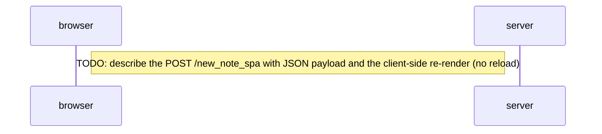

# 0.6: New note in Single page app diagram

Sequence diagram of the traffic when a user creates a new note on the single page
app version of the example app at https://studies.cs.helsinki.fi/exampleapp/spa

